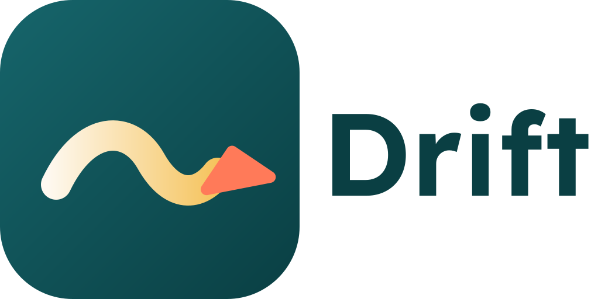
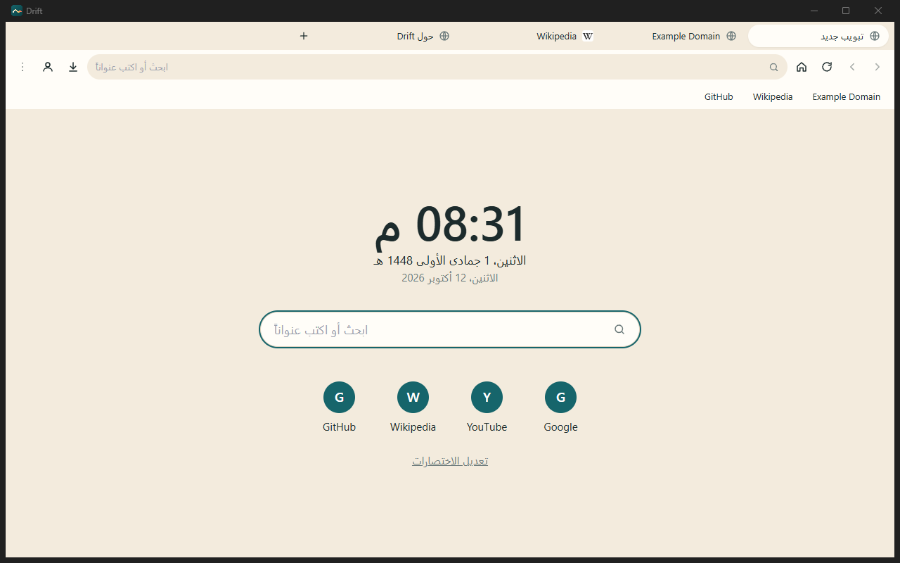
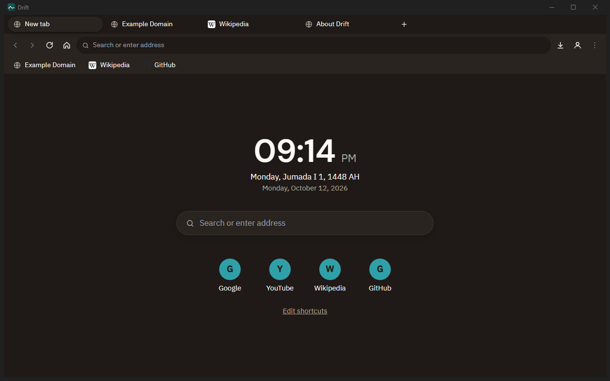
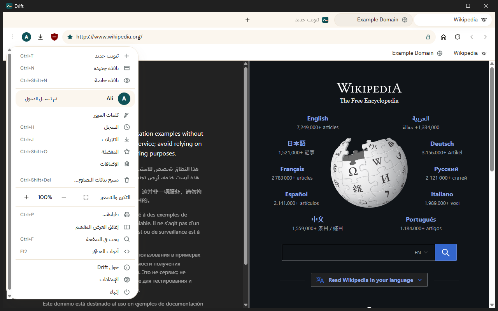
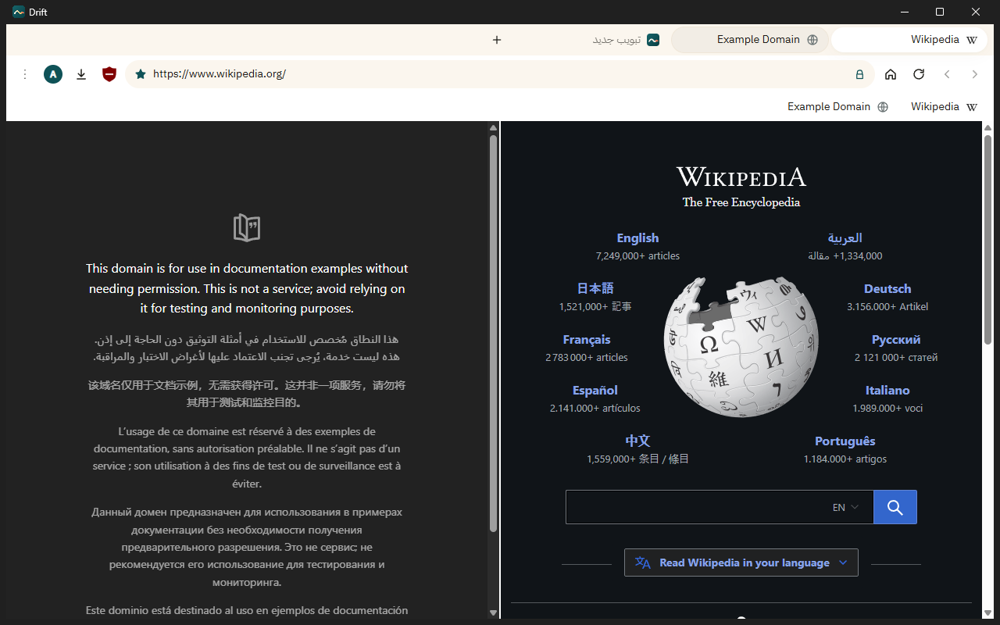
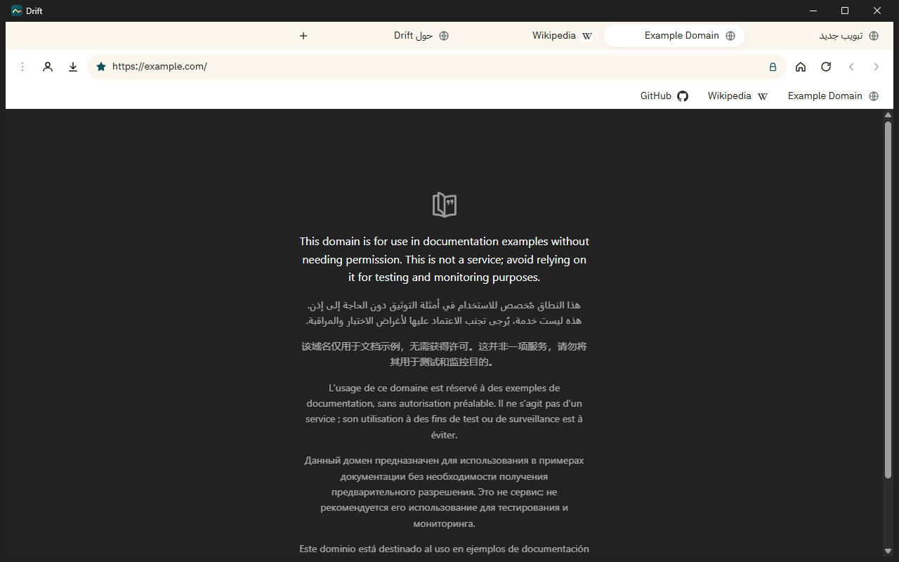
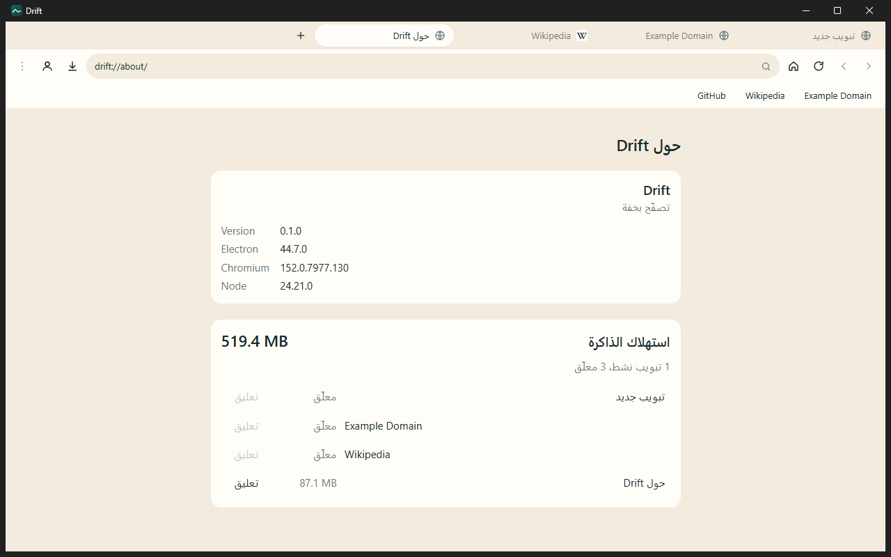

**تصفّح بخفة.**

متصفح سطح مكتب صغير وسريع، يدعم العربية (RTL) والإنجليزية من الأساس.

[الموقع](https://drift-browser.netlify.app) · [التحميل](https://github.com/l7v0l/drift-browser/releases/latest) · [English](README.md) · العربية

  
  

## المميزات

- **التبويبات**: فتح وإغلاق وتبديل، سحب لتغيير الترتيب، تثبيت، أيقونة كل موقع، وإعادة فتح آخر تبويب مغلق (`Ctrl+Shift+T`)
- **شريط العنوان**: رجوع وتقدّم وتحديث وإيقاف والرئيسية، وقفل HTTPS. الكلام العادي يبحث عنه بمحرك البحث المختار (Google أو Bing أو DuckDuckGo) مع اقتراحات من السجل والمفضلة
- **صفحة البداية**: الساعة، التاريخ الهجري والميلادي، مربع بحث كبير، واختصارات قابلة للتعديل
- **المفضلة والسجل والتنزيلات**: نجمة وشريط مفضلة، سجل فيه بحث ومسح حسب المدة، ولوحة تنزيلات بشريط تقدّم
- **النوافذ الخاصة**: لا يُحفظ شيء، لا سجل ولا كوكيز ولا جلسة
- **مدير كلمات المرور**: يعرض حفظ بيانات الدخول عند تسجيل الدخول أو إنشاء حساب ويملؤها لك لاحقاً. مشفّرة بمفتاح نظام التشغيل (Windows DPAPI)، وتديرها من `drift://passwords`
- **الإضافات**: ثبّت من متجر Chrome وتظهر أيقوناتها في الشريط (واجهة إضافات أساسية، راجع [docs/EXTENSIONS.md](docs/EXTENSIONS.md))
- **العرض المقسّم**: صفحتان جنباً إلى جنب
- **قائمة التبويب**: بالضغط يميناً على التبويب: إعادة تحميل، تكرار، تثبيت، كتم الصوت، إغلاق الباقي
- **شاشة البداية و«الجديد»**: شاشة بداية متحركة، ونافذة بالتغييرات بعد كل تحديث
- **البحث في الصفحة** (`Ctrl+F`) و**التكبير والتصغير** (`Ctrl +` و`-` و`0`)
- **استعادة الجلسة**: ترجع تبويباتك عند فتح Drift
- **خفيف على الذاكرة**: تعليق التبويبات الخاملة تلقائياً، وتحميل كسول، وصفحة `drift://about` تعرض استهلاك الذاكرة لكل تبويب
- **مظهر فاتح وداكن وتلقائي**، وواجهة عربية (الافتراضي، RTL) وإنجليزية
- **تسجيل دخول اختياري** بحساب Google أو Microsoft: يظهر بريدك جاهزاً في صفحات تسجيل الدخول الخاصة بهما (راجع [docs/SIGN_IN.md](docs/SIGN_IN.md))
- **صفحات داخلية**: `drift://settings` و`drift://history` و`drift://bookmarks` و`drift://downloads` و`drift://passwords` و`drift://extensions` و`drift://about`

  
  

  
  

