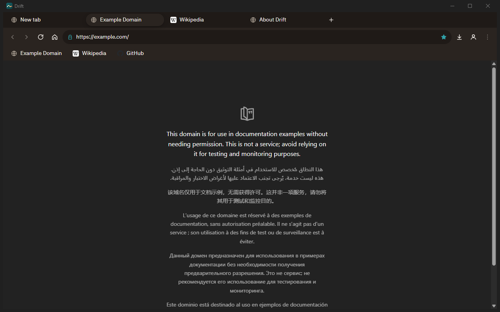

**Browse light.**

A small, fast desktop browser with first-class Arabic (RTL) and English support.

[Website](https://drift-browser.netlify.app) · [Download](https://github.com/l7v0l/drift-browser/releases/latest) · English · [العربية](README.ar.md)

  
  

## Features

- **Tabs** – open, close, switch, drag to reorder, pin, favicons, reopen closed tab (`Ctrl+Shift+T`)
- **Address bar** – back / forward / reload / stop / home, HTTPS lock, plain text searches with your chosen engine (Google, Bing, DuckDuckGo), suggestions from history and bookmarks
- **New tab page** – clock, Hijri and Gregorian dates, big search box, editable shortcuts
- **Bookmarks, history, downloads** – star button, bookmarks bar, searchable history with clear-by-range, download panel with progress
- **Private windows** – nothing is saved: no history, cookies or session
- **Find in page** (`Ctrl+F`) and **zoom** (`Ctrl +` / `-` / `0`)
- **Session restore** – your tabs come back when you reopen Drift
- **Light on memory** – idle tabs are discarded automatically, pages load lazily, and `drift://about` shows memory use per tab
- **Light / dark / auto theme**, Arabic (default, RTL) and English UI
- **Optional sign-in** with Google or Microsoft: your email is pre-filled on Google / Microsoft sign-in pages (see [docs/SIGN_IN.md](docs/SIGN_IN.md))
- **Internal pages** – `drift://settings`, `drift://history`, `drift://bookmarks`, `drift://downloads`, `drift://about`

  
  

